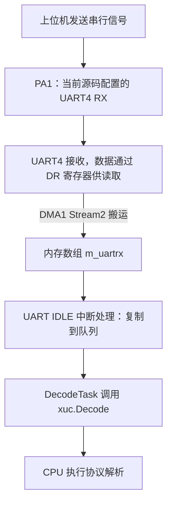

# 第 1 课：UART 收字节，DMA 搬字节，CPU 解释字节

日期：2026-11-04  
阶段：UART 与 DMA  
预算：阅读约 7 分钟，练习约 6 分钟，回复约 2 分钟  
状态：课程已提供，练习和理解程度待用户反馈。用户反馈聊天丢失后已重讲，仍未确认掌握。

## 从一个真实问题开始

上位机发送了一串表示云台目标的数据。STM32 是怎样得到它的？

今天先掌握分工：UART 将串行信号接收成字节；DMA 按配置把字节搬入内存；CPU 执行解析程序，判断字节表示什么。UART 和 DMA 都是芯片里的硬件模块，CPU 是执行程序指令的处理器核心。

这是第一课，没有上一课需要复习。先想一想：调用一个接收初始化函数后，后续字节是谁逐个放进数组的？读完再回答即可。

## 先跟一遍工程里的路径



图里的前半段由硬件接收和搬运，后半段的中断处理、队列操作和解析由 CPU 执行。今天先抓住这条路径，IDLE 和队列的细节留给后续课程。

这里的 IDLE 表示串口检测到一段空闲。空闲事件可用于取出一批收到的字节，但这批字节不一定恰好等于一个完整协议包；协议解析仍需判断边界。

## 对照你会调用的函数

工程根目录：`D:/01_RoboMaster/vault/Sentinel_robot`。以下路径均相对于此目录，行号为本次读取时的位置。

在 `STM32F405/STM32F405.cpp:114`，你能看到：

```cpp
xuc.Init(&uart4, UART4, 921600);
```

这选择 UART4，并传入波特率 921600。顺着跳到 `STM32F405/xuc.cpp:52`：

```cpp
huart->Init(Instance, BaudRate).DMARxInit(nullptr).DMATxInit();
```

先配置 UART，再设置 DMA 接收和发送。这里连续写调用，是因为这些函数返回当前 UART 对象的引用。你平时调用的一行函数，底下会做多项硬件配置。

打开 `STM32F405/usart.cpp:53` 的 `UART::DMARxInit()`，先只关注三个名字：

| 配置 | 可以先怎样理解 | 当前工程的接收设置 |
| --- | --- | --- |
| `PAR` | 从哪个外设地址取数据 | `&huart.Instance->DR` |
| `M0AR` | 向哪个内存地址写数据 | 默认是 `m_uartrx` 数组的起始地址 |
| `NDTR` | 还要传多少个数据单元 | 默认初始化为 100；本工程按字节传输 |

寄存器可以先理解成硬件暴露给程序的控制或状态位置。CPU 写这些配置，DMA 随后按配置响应接收请求，搬运字节；CPU 不需要为 DMA 搬运的每一个字节执行一次数组赋值。

`nullptr` 在这里触发函数里的默认缓冲区选择：`buffer = m_uartrx`。100 来自 `STM32F405/usart.h:16` 的 `UART_MAX_LEN`，表示默认接收缓冲区容量。它不代表上位机每次一定发送 100 字节，也不代表每个协议包长 100 字节。

## 为什么搬完还要解析

假设收到两个字节 `0x01 0x02`，它们可能是两个独立字段，也可能合起来表示一个数字。解释方式由通信双方约定的协议决定。

DMA 把这些字节放进数组后，CPU 还要执行程序检查数据。在当前工程中，`STM32F405/taskslist.cpp:174` 调用 `xuc.Decode()`；`STM32F405/xuc.cpp:103` 从队列取数据，随后调用 `AppendRx()` 和 `ParseRx()`。

这就是为什么“数组里有数据”和“收到一个有效控制命令”是两个需要分别验证的步骤。将来遇到“串口收到数据但机器人没反应”，你就能沿路径逐段定位，而不只盯着最外层函数调用。

## 六分钟练习：看代码，画箭头

今天只需阅读和记录，不需要连接硬件。

1. 找到 `STM32F405/usart.cpp:267` 的 UART4 分支，确认接收方向是 `DMA_PERIPH_TO_MEMORY`，找出 `PeriphInc` 和 `MemInc` 的配置。
2. 自己写一条路径：`UART4 的 DR -> ______ -> ______ -> xuc.Decode()`。不确定的格子先写问号。
3. 用自己的话回答：为什么外设地址不递增，而内存地址递增？提示：想象连续收到三个字节时，源头和落点分别在哪里。

完成信号：能说清 UART、DMA、CPU 各自的职责，并指出 DMA 接收的源地址和目标地址。不要求背寄存器名称。

## 待回复

- 理解题：DMA 已经把字节放进数组，为什么还需要 `xuc.Decode()`？用自己的话说一两句。
- 小练习：外设地址不递增、内存地址递增的原因是什么？
- 背景问题：你以前用 CubeMX 配过 UART 接收吗？用过阻塞接收、逐字节中断接收、DMA 接收中的哪些？不知道这些名称也可以直接说。

用户答案：尚未收到。不能据此标记为已掌握。

## 补充课：NDTR 是倒计时，地址是落点

这一节把上一课最关键的硬件动作补完整：DMA 不只是“把数据搬进数组”，它还知道自己还剩多少字节要搬，以及下一字节该放到哪里。

### 先看 `NDTR`

在 `STM32F405/usart.cpp:58`，初始化时把 `NDTR` 设成 `size`。这个例子里 `size` 是 `UART_MAX_LEN`，实际值为 100。可以把 `NDTR` 理解成“还需要搬运多少字节”的倒计时。

假设上位机这次实际发送了 3 个字节：

```text
初始化 NDTR = 100
收到第 1 个字节后 NDTR = 99
收到第 2 个字节后 NDTR = 98
收到第 3 个字节后 NDTR = 97
实际收到的字节数 = 100 - 97 = 3
```

所以当前工程在 `STM32F405/usart.cpp:465-469` 读取 `NDTR`，再用 `UART_MAX_LEN - ndtr` 算出真实长度，保存到 `rx_len`。这一步很重要：`m_uartrx` 是容量为 100 的缓冲区，并不表示这次收到的数据有 100 字节。

接收缓冲区不会自动清零。假设上一次短帧留下了旧内容，这次只收到 3 个新字节；如果程序把整个 100 字节都当成有效数据，后面的旧内容就可能被误当做新数据。因此消费者必须使用 `GetRxLen()` 得到的真实长度，而不能只拿到数组地址就认为数组内容全都有效。`STM32F405/xuc.cpp:114` 的 `AppendRx(m_frame, frame_len)` 正是在使用这个长度。

### 再看源地址和目标地址

UART4 接收时，数据来源是固定的数据寄存器 `DR`。每个新字节都从这个寄存器出现，DMA 再来取走，所以外设地址不应该递增：

```text
UART4->DR       固定位置
     |
     +--> 第 1 个字节
     +--> 第 2 个字节
     +--> 第 3 个字节
```

目标则是内存数组。为了让三个字节依次放进三个位置，内存地址需要递增。假设 `m_uartrx` 的首地址是 `0x20000000`，并且每传输一个字节只移动一个地址：

```text
第 1 个字节 -> 0x20000000
第 2 个字节 -> 0x20000001
第 3 个字节 -> 0x20000002
```

这就对应 `STM32F405/usart.cpp:292-293` 附近的配置含义：

- `PeriphInc = DMA_PINC_DISABLE`：源头 `DR` 不递增。
- `MemInc = DMA_MINC_ENABLE`：目标数组递增。

可以把这两个设置记成一句话：**源头是同一个出口，落点要排成一排。**

### 三分钟练习

这次收到 7 个字节，假设接收缓冲区从 `0x20000000` 开始，初始 `NDTR` 是 100：

1. 收到 7 个字节后，`NDTR` 应该是多少？
2. 这 7 个字节实际占用 `0x20000000` 到哪个地址？
3. 如果程序错误地把 100 个字节全部交给解析器，可能发生什么问题？

完成信号：能根据 `NDTR` 算出真实长度，并能说明 `PeriphInc` 和 `MemInc` 为什么这样设置。只需要回答思路，不需要运行或烧录代码。

## 下次怎么接

下一节：波特率、8N1 与接收时间预算。用当前 921600 的设置计算一个字节和一段数据大约需要多久，再连接到“CPU 为什么需要 DMA 帮忙搬运”。

若尚未收到本课反馈，下次先做简短回顾或换例子巩固，不把未回复等同于已掌握。今天的补充内容与第一课共同计入“UART 数据入口”主题，不另算一个过大的新阶段。

## 依据与边界

- 工程依据：本次直接读取上述源文件。`usart.cpp:267-318` 的 UART4 分支实际配置 GPIOA 的 PA0/PA1；`STM32F405.cpp:114` 旁的 PC10/PC11 注释与之不一致。本课按配置语句解释，不据此断言实物接线。
- 延伸阅读候选：ST AN4031《Using the STM32F2, STM32F4 and STM32F7 Series DMA controller》。本次在线检索未返回可读取内容，以下链接待在线核验，本课的工程配置以已读取源码为依据：<https://www.st.com/resource/en/application_note/an4031-using-the-stm32f2-stm32f4-and-stm32f7-series-dma-controller-stmicroelectronics.pdf>。
- 今日是周三；招聘要求观察按约定在周五补充，本课没有声称已调查招聘岗位。
- 本次是源码阅读和教学准备，未进行编译、烧录或硬件验证。固件源码未修改。
