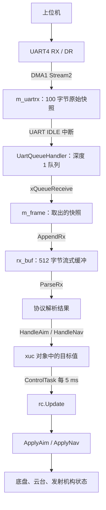

# 补讲：从 UART 到控制任务的完整数据流

日期：2026-11-06  
阶段：UART 与 DMA  
状态：用户提出“缓冲区之后不懂”，已重新讲解，待用户反馈。

## 这次先纠正一个词

你记得的 `MOAR` 在源码里是 **`M0AR`**，中间是数字 `0`，不是字母 `O`。它是 DMA 的目标内存地址寄存器。`PAR` 是外设地址，`M0AR` 是内存地址；接收时 DMA 从 `PAR` 指向的 UART 数据寄存器取字节，写到 `M0AR` 指向的数组。

## 用一张图看完整路径



先记住：**DMA 负责硬件搬运，队列负责任务间传递，`rx_buf` 负责拼接协议流，控制任务负责把解析结果变成执行器目标。**

## 第一层：DMA 缓冲 `m_uartrx`

`STM32F405/usart.h:57` 定义了 `m_uartrx[100]`。它接收的是原始字节流，不负责判断一帧从哪里开始、到哪里结束。

它不是永久保存历史数据的日志：

- DMA 每次接收都往这个数组写；
- 本工程用 `NDTR` 计算本次实际收到的长度；
- 下一次接收开始前会把计数器重置；
- 数组内容不一定被清零，所以只能使用本次有效长度。

这段“原始接收”发生在 `STM32F405/usart.cpp:53` 的 `DMARxInit()` 中。DMA 配置好之后，CPU 不需要为每个字节执行一次 `m_uartrx[i] = ...`。

## 第二层：IDLE 中断把快照放进队列

UART 接收到一段数据后，如果线路进入空闲状态，会触发 IDLE 中断。中断处理函数 `OnUARTITHandler()` 位于 `STM32F405/usart.cpp:453`。

它主要做四件事：

1. 暂停 DMA；
2. 读取 `NDTR`，算出本次这一批数据的真实长度；
3. 记录到达时间和长度；
4. 把 `m_uartrx` 的内容复制到 FreeRTOS 队列。

当前队列在 `STM32F405/usart.h:53` 创建：

```cpp
QueueHandle_t UartQueueHandler = xQueueCreate(1, UART_MAX_LEN);
```

这表示：

- 队列深度是 1，只能保存一份未处理快照；
- 每份快照的大小是 100 字节；
- 中断里使用 `xQueueOverwriteFromISR()`，新快照会覆盖旧快照；
- 如果任务还没来得及取，第二份快照又到了，旧的会丢失，并增加 `rx_drop_cnt`。

这里的“一帧”暂时可以理解成“一次空闲前收到的这一批字节”。它不保证等于协议上的完整帧。一个协议帧可能跨多次 UART 接收到来，也可能一次 UART 接收里包含多个协议帧。

## 第三层：为什么还需要队列

UART 中断属于中断上下文，不适合在里面做长时间的协议解析、内存操作和控制逻辑。

所以中断只做“尽快把原始快照交给任务”这件事，然后返回。真正的解析放在普通任务中执行。

FreeRTOS 在这里提供的是队列和任务调度：

- `xQueueOverwriteFromISR()`：中断把快照放进队列；
- `xQueueReceive()`：任务把快照取出来；
- `xTaskCreate()`：创建任务；
- `vTaskDelay()`：让任务暂时等待，让调度器运行其他任务。

FreeRTOS 不是“另一个负责搬运字节的硬件”。CPU 仍然执行代码；FreeRTOS 决定哪个任务在什么时候运行。

## 第四层：`DecodeTask` 取快照

`STM32F405/taskslist.cpp:150` 的 `DecodeTask()` 是一个每 5 毫秒循环一次的任务，核心顺序是：

```cpp
rc.Decode();
imu_pantile.Decode();
imu_chassis.Decode();
xuc.Decode();
vTaskDelay(5);
```

这里的 `xuc.Decode()` 在 `STM32F405/xuc.cpp:93`：

```cpp
if (xQueueReceive(*queue_handler, m_frame, 0) == pdTRUE)
{
    frame_time_us = m_uart->GetRxTimeUs();
    frame_len     = m_uart->GetRxLen();
    AppendRx(m_frame, frame_len);
}
ParseRx();
```

逐句理解：

- `xQueueReceive` 从队列取出一份 100 字节快照；
- `m_frame` 是这次取出的快照副本；
- `frame_len` 告诉后续代码这次实际有多少字节有效；
- `AppendRx` 只把有效字节追加到协议层缓冲区；
- `ParseRx` 在 CPU 上执行解析。

`m_frame` 不负责长期保存历史数据。它只是“这次从队列里取出来的一份快照”。

## 第五层：`rx_buf` 才是协议层的流式缓冲区

`STM32F405/xuc.h:221` 有 `rx_buf[512]`，`xuc.cpp:121` 的 `AppendRx()` 会把新到的有效字节追加进去：

```cpp
memcpy(rx_buf + rx_len, p, n);
rx_len += n;
```

这里的 `rx_buf` 与 UART 的 `m_uartrx` 不是同一个数组：

| 数组 | 在哪里 | 作用 | 生命周期 |
| --- | --- | --- | --- |
| `m_uartrx[100]` | UART 对象 | DMA 接收落点 | 每次 UART 接收覆盖 |
| `m_frame[100]` | XUC 对象 | 从队列取出的快照 | 每次 `xuc.Decode` 覆盖 |
| `rx_buf[512]` | XUC 对象 | 拼接跨多次接收的协议字节 | 解析器持续维护 |

`rx_buf` 的容量是 512 字节，因为它在协议层有额外余量，能容纳多个帧、半帧和噪声字节。DMA 的 100 字节只是硬件接收快照的上限。

还要注意有两个不同对象的 `rx_len`：

- `uart4.rx_len`：本次 UART/DMA 快照的真实长度；
- `xuc.rx_len`：当前 `rx_buf` 里已经积累了多少字节。

名字相同但所属对象不同，这是阅读源码时容易混淆的地方。

## 第六层：`ParseRx()` 如何理解和拆分字节

`STM32F405/xuc.cpp:156` 的 `ParseRx()` 会扫描 `rx_buf`：

1. 找到帧头 `A6 6A`；
2. 检查版本和长度；
3. 等待整帧到齐；
4. 计算 CRC；
5. 按消息类型调用 `HandleAim()` 或 `HandleNav()`；
6. 已消费的字节从 `rx_buf` 清掉，未消费的半帧留在缓冲区，等待下一次 `DecodeTask` 再拼接。

所以“接收一次”与“解析出一帧”不是一回事：

```text
一次 UART 接收 -> 可能只有半帧 -> 留在 rx_buf
下一次 UART 接收 -> 补齐后半帧 -> ParseRx 才能解析
一次 UART 接收 -> 也可能包含两个完整帧 -> ParseRx 连续消费两个帧
```

当前代码还保留了半帧超时机制：如果候选帧长时间不完整，就丢弃一部分字节并重新找帧头。这说明 `rx_buf` 的职责不是单纯存放数据，而是维护“跨多次接收的协议流”。

## 第七层：控制任务从哪里接手

`DecodeTask` 的主要职责是“接收并解析”。它并不会在解析完成后直接驱动电机。

另一个任务 `ControlTask()` 位于 `STM32F405/taskslist.cpp` 的控制任务区，每 5 毫秒执行：

```cpp
rc.Update();
ctrl.chassis.Update();
ctrl.pantile.Update();
ctrl.shooter.Update();
vTaskDelay(5);
```

`rc.Update()` 在 `STM32F405/RC.cpp` 中依次调用：

```cpp
OnRC();
OnPC();
```

而 `OnPC()` 会根据遥控器模式，在 AUTO 模式下调用：

```cpp
ApplyNav(); // 0x11 NAV_COMMAND -> 底盘
ApplyAim(); // 0x10 AIM_COMMAND -> 云台
```

这条链可以总结为：

```text
UART 中断：交出一批原始字节
    ↓
xuc.Decode：把原始字节接入流式解析器
    ↓
ParseRx：把字节变成 xuc 对象中的目标值
    ↓
ControlTask：读取目标值并更新控制状态
    ↓
ApplyNav / ApplyAim：写底盘、云台、发射机构指令
```

`xuc` 对象因此像一个“解析结果的共享信箱”：`DecodeTask` 写入，`ControlTask` 每 5 毫秒读取。两个任务通过对象字段传递结果，不需要把字节从 `DecodeTask` 再复制给 `ControlTask`。

## 把整条链压缩成一句话

**DMA 把原始字节放进 `m_uartrx`；IDLE 中断把这一批快照放进深度为 1 的队列；`DecodeTask` 每 5 毫秒取快照并追加到 `rx_buf`；`ParseRx` 在 `rx_buf` 中拼出完整协议帧并写入 `xuc`；`ControlTask` 再读取 `xuc` 的结果，交给 `ApplyAim` 和 `ApplyNav`。**

## 五分钟练习

请只回答下面三个问题：

1. `m_uartrx`、`UartQueueHandler` 和 `rx_buf` 分别解决什么问题？
2. 为什么 `xuc.Decode()` 不能直接假定队列里恰好就是完整协议帧？
3. 如果 `DecodeTask` 还没取快照，UART 又收到一批数据，队列里的旧快照会发生什么？

完成信号：能区分“硬件接收缓冲区”“任务间队列”和“协议流式缓冲区”，并能说清 `DecodeTask`、`ControlTask` 的先后职责。

用户答案：尚未收到，不能默认已经理解。

## 下一步

收到你的回答后，下一课再用一个具体字节序列演示：

```text
A6 6A ... + 一个不完整帧 + 下一次补齐
```

重点观察 `ParseRx()` 为什么不会把半帧当成完整命令，以及控制任务为什么不会直接处理原始字节。

## 依据与边界

- 代码依据：`STM32F405/usart.h`、`usart.cpp`、`xuc.h`、`xuc.cpp`、`taskslist.cpp`、`RC.cpp`，以本次读取的当前源码为准。
- 本次仅做源码讲解，未编译、烧录或进行硬件验证；固件源码未修改。
