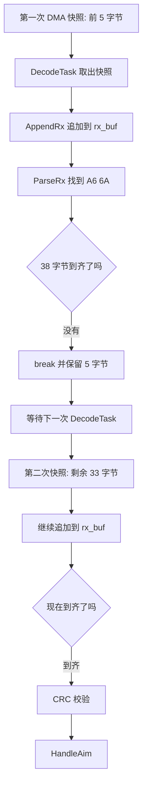

# 第 2 课：半帧为什么能留到下一次

日期：2026-11-07  
阶段：UART 与 DMA  
预算：复习 2 分钟，新课 7 分钟，练习 4 分钟，岗位观察 2 分钟  
状态：课程已提供，待用户反馈。

## 两分钟复习

昨天遗留的问题是：一次 UART 接收只收到半帧时，半帧留在哪里？

答案是 `xuc.rx_buf`。原因是：

1. `m_uartrx` 是 DMA 的接收落点，下一次接收可能覆盖它；
2. `UartQueueHandler` 是深度为 1 的最新快照队列，也保存不了长历史；
3. `xuc.Decode()` 已经把本次有效字节复制到 `rx_buf`；
4. `ParseRx()` 发现帧不完整时退出本轮扫描，后面的 `memmove` 把未消费字节保留在 `rx_buf` 开头；
5. 下一次 `DecodeTask` 再把新字节追加到后面，继续拼接。

所以 `rx_buf` 保存的是协议解析进度，`m_uartrx` 保存的只是最近一次硬件接收结果。

## 今天的核心：一次接收不等于一个协议帧

当前协议帧由三部分组成：

```text
12 字节帧头 + N 字节负载 + 2 字节 CRC
总长度 = 14 + N
```

依据在 `STM32F405/xuc.h:38-45`：

- 帧头前两字节是 `A6 6A`；
- 固定帧头长度为 12；
- CRC 长度为 2；
- 最大负载为 128 字节。

最大帧长是：

```text
12 + 128 + 2 = 142 字节
```

但 DMA 快照和队列项的上限是 100 字节：

```text
UART_MAX_LEN = 100
```

所以协议层本来就必须允许“一个帧跨多次 UART 接收”。这也是 `rx_buf` 容量为 512 字节的原因，它在 `STM32F405/xuc.h:140` 定义。

今天用云台指令 `AIM_COMMAND` 举例。它的负载是 24 字节，因此完整帧长是：

```text
12 + 24 + 2 = 38 字节
```

假设第一次 DMA 快照只拿到了前 5 个字节：

```text
A6 6A 02 10 18
```

`ParseRx()` 在 `STM32F405/xuc.cpp:161-182` 会这样做：

1. 在 `rx_buf[i]`、`rx_buf[i+1]` 找到 `A6 6A`；
2. 发现当前只有 5 字节，小于固定帧头 12 字节；
3. 记录 `pending_ms`；
4. 执行 `break`，本轮不再继续解析；
5. 函数末尾执行 `memmove`，把这 5 字节留在 `rx_buf` 开头。

下一次快照带来剩余字节后，`AppendRx()` 把它们追加到 `rx_buf` 后面。`ParseRx()` 再次从 `A6 6A` 开始检查，只有整帧 38 字节都到齐，才会做 CRC 校验并调用 `HandleAim()`。

## 用流程图看跨快照拼接



这条路径解释了 `DecodeTask` 为什么每 5 ms 运行一次，而协议帧仍然可以跨周期拼接：任务每次只处理新到的快照，`rx_buf` 保存未完成的进度。

## 解析器如何丢掉噪声和已消费数据

`ParseRx()` 从 `i = 0` 开始扫描：

- 当前字节不是 `A6`，或下一字节不是 `6A`，就执行 `++i` 往后找；
- 找到帧头但长度不够，就等待；
- 完整帧 CRC 正确并处理完后，执行 `i += total` 跳过整帧；
- 扫描结束后，把 `rx_buf + i` 剩下的内容移到缓冲区开头。

所以 `rx_buf` 里通常只会留下两类内容：

1. 尚未补齐的候选帧；
2. 暂时无法确认的尾部数据。

如果候选帧超过 100 ms 仍然无法补齐，`ParseRx()` 会增加 `resync_cnt`，丢弃一个字节并重新寻找帧头。这避免一个假帧头让解析器永久卡住。

## 需要警惕的队列覆盖

`rx_buf` 流式缓冲能处理“半帧”，但前提是快照成功进入了队列并被 `DecodeTask` 取走。

当前队列深度是 1，中断使用覆盖写：如果任务还没取走第一份快照，第二份就到了，第一份会丢失。对应源码是：

- `STM32F405/usart.h:53`：建立深度为 1 的队列；
- `STM32F405/usart.cpp:479-482`：发现队列已有数据时增加 `rx_drop_cnt`，然后覆盖旧快照。

因此要分开判断两类问题：

| 现象 | 可能原因 |
| --- | --- |
| `rx_drop_cnt` 增长 | 任务取快照的速度跟不上 UART 批次到达速度 |
| `resync_cnt` 增长 | 数据流里有噪声、假帧头，或帧长期不完整 |
| `crc_err` 增长 | 帧长度够了，但内容在传输或组帧时不可靠 |

这说明“增大 `rx_buf`”不能解决所有丢数据问题；如果队列里的快照已经被覆盖，协议缓冲区根本没有机会拿到那段字节。

## 四分钟练习：判断每一步落在哪里

请只写答案，不需要改代码：

1. 第一次快照只有 `A6 6A 02 10 18`，它最终留在 `m_uartrx`、队列、`rx_buf` 中的哪里？
2. 第二次快照补齐了整帧，`ParseRx()` 通过 CRC 后，会把结果交给哪个函数？
3. 如果第一份快照还没被 `DecodeTask` 取走，第二份快照就到了，什么问题可能发生？

完成信号：能说清“硬件快照—队列—协议流缓冲—解析结果”四层，并能区分 `rx_drop_cnt` 与 `resync_cnt`。

用户答案：尚未收到，不能默认已经理解。

## 周五岗位要求观察

来源：小米招聘官网职位搜索页 <https://hr.xiaomi.com/opportunities.html?q=嵌入式>。  
本次通过官网公开搜索接口读到以下岗位，页面标注发布时间均为 2026-08-11。招聘状态可能变化，以下只用于识别能力方向，不代表当前一定仍可投递。

### 岗位一：嵌入式软件开发工程师

岗位页面：<https://xiaomi.jobs.f.mioffice.cn/campus/position/7671128909705922843/detail>

岗位职责原文中的关键点：

- 负责嵌入式系统的软件设计、开发、调试与维护；
- 编写底层驱动程序，实现与硬件的交互；
- 开发基于 RTOS（如 FreeRTOS、uC/OS 等）或裸机的应用程序；
- 配合硬件工程师完成系统联调、性能优化和问题排查。

任职要求原文中的关键点：

- 熟练掌握 C 语言；
- 熟悉 ARM Cortex-M 系列、STM32 等嵌入式平台；
- 熟悉 SPI、I2C、UART、CAN、USB 等接口协议；
- 有 FreeRTOS、ThreadX、RT-Thread 等 RTOS 开发经验者优先。

### 岗位二：嵌入式软件工程师-汽车

岗位页面：<https://xiaomi.jobs.f.mioffice.cn/campus/position/7670931263595268388/detail>

岗位职责原文中的关键点：

- 负责 BMS、域控制器等嵌入式底层软件开发；
- 负责复杂驱动、Bootloader 开发与测试；
- 负责软件调试和相关问题解决。

任职要求原文中的关键点：

- 至少熟悉一种编程语言，例如 C/C++；
- 有嵌入式编程经验者优先；
- 有嵌入式硬件开发和调试经验者优先。

### 与 Sentinel 当前学习内容的映射

| 岗位要求 | 当前工程对应内容 | 下一步应补的能力 |
| --- | --- | --- |
| UART、SPI、I2C、CAN | UART4 + DMA 接收 | 能解释接口时序、缓冲区和错误处理 |
| STM32、Cortex-M | STM32F405、HAL、中断和寄存器配置 | 能从 HAL 调用追到外设寄存器和中断 |
| FreeRTOS/RTOS | `DecodeTask`、`ControlTask`、深度 1 队列 | 能分析任务周期、队列覆盖和优先级 |
| 底层驱动 | `usart.cpp`、DMA、IDLE 中断 | 能独立写小型接收驱动并做台架测试 |
| 调试与问题排查 | `rx_drop_cnt`、`resync_cnt`、`crc_err` | 能用计数器形成可验证的排查步骤 |

今天的学习重点与招聘要求是连着的：岗位要求里的“熟悉 UART”不只表示会调用串口函数，还要求能解释 DMA、缓冲区、半帧拼接、丢包和调试证据。后续课程会逐步补上这些工程能力。

## 下次怎么接

下一课先看你的练习答案，再用一个具体字节序列走完：

```text
帧头 -> 负载长度 -> 等待完整帧 -> CRC -> HandleAim
```

如果今天没有回复，下次会用更短的两段快照重新演示，不默认你已经掌握。

## 依据与边界

- 工程依据：本次直接读取 `STM32F405/xuc.h`、`xuc.cpp`、`usart.h`、`usart.cpp`、`taskslist.cpp`。
- 招聘依据：小米招聘官网公开搜索接口和岗位详情链接；只提取页面给出的职责与要求，不推断未写出的条件。
- 未进行编译、烧录、在线调试或硬件验证；本次未修改 Sentinel 固件源码。
