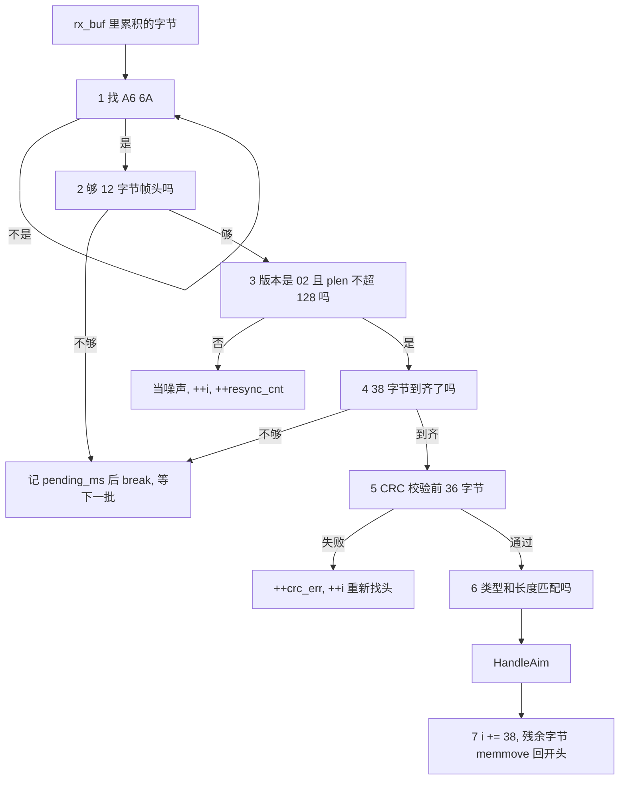

# 第 3 课：一个 AIM_COMMAND 帧的 38 字节

日期：2026-11-08  
阶段：UART 与 DMA  
预算：复习 2 分钟，新课 7 分钟，练习 4 分钟  
状态：课程已提供，待用户反馈。今天是周日，按约定不补招聘要求观察（上周五已做过一次）。

## 两分钟复习

上次的三个问题还没收到答案，这里不重复讲，只把问题留在下面，你想回答时再答：

1. 第一次快照只有 `A6 6A 02 10 18`，它最终留在哪里？
2. 第二份快照覆盖第一份时，什么问题可能发生？
3. `rx_drop_cnt` 和 `resync_cnt` 分别说明什么问题？

另外看到你今天自己写了 [[11.8Rtos与中断]]。那部分基本是对的，而且今天正好用得上：

- `vTaskDelay(5)` 的 5 是 Tick 不是毫秒，这个判断是对的。本工程在 `STM32F405/FreeRTOSConfig.h:69` 把 Tick 配成 1000 Hz，所以这里恰好 5 Tick = 5 ms。换成配 100 Hz 的工程，同样一行代码就是 50 ms，所以你留的这个心眼是个真问题。
- 任务被抢占后从 Running 变 Ready，也对。`STM32F405/FreeRTOSConfig.h:63` 是 `configUSE_PREEMPTION 1`，抢占式调度确实会这样。
- 一处小修正：Blocked 状态的任务不是“不在任何列表里”，它被放进了延迟列表等时间到；只是不在就绪列表里。所以时间一到，它先回 Ready，再等调度器轮到它。
- 中断被更高优先级的中断抢占时，正在跑的那个 ISR 是“正在服务但被挂起”，不会退回 pending。你说的方向对：pending 表示已经请求、还没进去服务。

今天的新课把这两条线接起来：协议帧到底长什么样，以及它什么时候被轮到。

## 今天的核心：38 个字节怎么变成云台目标

### 先看帧的骨架

一个 AIM_COMMAND 帧固定 38 字节：

```text
12 字节帧头 + 24 字节负载 + 2 字节 CRC = 38
```

依据在 `STM32F405/xuc.h`：

- `xuc.h:38-39`：帧头前两字节是 `A6 6A`；
- `xuc.h:41`：帧头固定 12 字节；
- `xuc.h:42`：CRC 2 字节；
- `xuc.h:63`：AIM_COMMAND 负载固定 24 字节。

### 一个具体帧长什么样

下面这 38 字节是一个完整例子。`boot_id`、`ref_time`、`ref_seq` 是示意值，真实运行时要和机器人自己的对得上，下面会讲为什么：

```text
A6 6A 02 10 18 00 2A 00 5A 3C 01 00
00 00 00 00
01 00 07 00 80 84 1E 00
64 00 07 00
CD CC 4C 3D 8F C2 F5 BC
C1 21
```

按字段拆开：

| 帧内偏移 | 字节 | 含义 | 谁在读 |
| --- | --- | --- | --- |
| 0 | `A6` | 帧头第 1 字节 | `xuc.cpp:164` |
| 1 | `6A` | 帧头第 2 字节 | `xuc.cpp:164` |
| 2 | `02` | 协议版本，必须等于 `XUC_VERSION` | `xuc.cpp:184,189` |
| 3 | `10` | 消息类型，`0x10` = AIM_COMMAND | `xuc.cpp:185,239` |
| 4-5 | `18 00` | 负载长度 = 24，低字节在前 | `xuc.cpp:186` |
| 6-7 | `2A 00` | 帧序号 = 42，低字节在前 | `xuc.cpp:235` |
| 8-11 | `5A 3C 01 00` | `boot_id` = 0x00013C5A | `xuc.cpp:236,268` |
| 12-15 | `00 00 00 00` | 负载前 4 字节，协议规定填 0 | 无人读，占位 |
| 16-17 | `01 00` | `ref_epoch` = 1 | `xuc.cpp:270,310` |
| 18-19 | `07 00` | `ref_seq` = 7 | `xuc.cpp:271,311` |
| 20-23 | `80 84 1E 00` | `ref_time` = 2000000 µs | `xuc.cpp:272,318` |
| 24-25 | `64 00` | `valid_for_ms` = 100 | `xuc.cpp:273,321` |
| 26 | `07` | `flags`：bit0 控制许可 + bit1 目标有效 + bit2 摩擦轮 | `xuc.cpp:274,279` |
| 27 | `00` | 保留位，必须填 0 | 无人读 |
| 28-31 | `CD CC 4C 3D` | `yaw_error` = +0.05 rad | `xuc.cpp:275,324` |
| 32-35 | `8F C2 F5 BC` | `pitch_error` = -0.03 rad | `xuc.cpp:276,325` |
| 36-37 | `C1 21` | CRC16，低字节在前 | `xuc.cpp:213` |

两个细节先记住：

- 所有多字节字段都是低字节在前（小端）。`18 00` 读出来是 24 而不是 0x1800，因为 `xuc.cpp:29-32` 的 `R2()` 写的是 `p[0] | (p[1] << 8)`。
- `flags` 在负载偏移 14，不在 0。`docs_通信协议.md:147` 专门标了这件事，因为这里错过一次。

### ParseRx 拿着这 38 字节做什么

`xuc.cpp:156` 的 `ParseRx()` 从 `rx_buf` 开头扫描，七步顺序固定：



对上前面的例子：

- 第 2 步：`rx_len - i` 小于 12 就 `break`（`xuc.cpp:171-182`）。半帧就是卡在这里。
- 第 4 步：`total = 12 + 24 + 2 = 38`（`xuc.cpp:196`），不足 38 就继续等（`xuc.cpp:199-210`）。
- 第 5 步：`VerifyCRC16CheckSum(rx_buf + i, 38)` 只覆盖前 36 字节（`xuc.cpp:213`）。实现在 `CRC.cpp:110-117`，比较时低字节放 `[36]`、高字节放 `[37]`。上面例子的 CRC 是 `C1 21`，我按这个算法算出来填回去的，你可以当作一个可复算的例子。

### HandleAim 通过之后写什么

`xuc.cpp:263` 的 `HandleAim()` 是一串资格检查，任何一步不过就记一个 `last_reject` 然后返回，不写目标值：

| 检查 | 位置 | 不过会怎样 |
| --- | --- | --- |
| `boot_id` 要等于本机 | `xuc.cpp:268` | `BAD_SESSION` |
| `flags` 不能有未定义位 | `xuc.cpp:279` | `INVALID_VALUE` |
| 两个误差必须是有限数 | `xuc.cpp:280` | `INVALID_VALUE` |
| 序号要比上一帧新 | `xuc.cpp:283-287` | `DUPLICATE_OR_OLD` |
| 参考样本四元组要查得到 | `xuc.cpp:310-312` | `BAD_REFERENCE` |
| 样本年龄不能超 `valid_for_ms` | `xuc.cpp:318-321` | `STALE` |

全过了才在 `xuc.cpp:324-334` 重建目标。这里是最容易搞反的一点：

```cpp
aim_yaw_target   = WrapPi(s->yaw + yaw_err);
aim_pitch_target = s->pitch + pit_err;
```

上位机发的是**误差**，不是绝对角度。`s` 是我们自己上行发出去、又被缓存的参考样本，`yaw_err` 是视觉说的“还差多少”。所以最终目标等于“我当时的姿态”加上“视觉让我补的误差”。

这也解释了第 5 行检查为什么存在：没有自己发过的姿态样本，误差就没有基准，直接加会跑偏。

### 谁接着用这个目标值

`HandleAim` 只写 `xuc` 对象的字段（`xuc.h:163-172`），不碰电机。真正执行在另一个任务：

```text
ControlTask 每 5 ms -> rc.Update() -> OnPC() -> ApplyAim()
```

`RC.cpp:123` 的 `ApplyAim()` 第一件事是问 `xuc.AimReady()`（`RC.cpp:135`）。`AimReady()` 在 `xuc.cpp:438`，查三件事：最近一帧通过检查、控制许可还开着、目标年龄没超 `valid_for_ms`。任一条不满足就 `return`，云台保持当前位置，不清零。

所以这 38 字节的旅程终点是两个 float：`aim_yaw_target` 和 `aim_pitch_target`，被 `ControlTask` 每 5 ms 读一次，和 IMU 当前角度相减得到误差，再推进云台电机（`RC.cpp:150-159`）。

### 和上周看到的代码有一处不同

`DecodeTask` 现在不只是收。`taskslist.cpp:167-186` 新增了一段上行发送：AUTO 模式下每 4 拍发一次 `xuc.Encode()`，也就是 50 Hz。所以你上周看的 `taskslist.cpp` 和现在的有一点点不同，以当前文件为准。它也顺便解释了“参考样本”从哪来：就是我们自己发上去的 IMU 数据帧。

## 时间感：一帧在线上只要 0.4 毫秒

波特率 921600，一帧 38 字节。`taskslist.cpp:158` 的注释里已经算好了：1 字节约 10.85 µs，所以：

```text
38 x 10.85 µs ≈ 412 µs
```

一帧在串口线上大约 0.41 毫秒就发完了，而 `DecodeTask` 每 5 毫秒才醒一次。也就是说字节早就到齐了，解析慢不是因为线，是因为任务要等调度。

这给你一个排查思路：遇到“云台不动”，先分清是没收到、没解析过、还是目标被拒绝。这三个阶段各有计数器可以看（`rx_total`、`rx_count`、`crc_err`、`last_reject`），下一课会讲怎么用它们形成步骤。

## 四分钟练习

只写答案，不改代码：

1. 假设这次快照只到了前 8 字节（magic 两字节 + 版本 + 类型 + 长度 + 序号），`ParseRx()` 会走到七步里的第几步停下来？此时 `rx_len` 是多少、`i` 是多少？
2. 第 36 字节 `C1` 在传输中被噪声改成了 `C2`，后面会发生什么？`crc_err` 会怎么变？`HandleAim()` 会被调用吗？
3. 如果 `flags` 那一字节是 `00`（控制许可位没置起），`HandleAim()` 会走哪条分支？云台会怎样？

完成信号：能指着 38 字节中的任意一个字节，说出它在七步里的哪一步被用到。

## 本次要点

- 一个 AIM_COMMAND 帧固定 38 字节：12 帧头 + 24 负载 + 2 CRC；协议最大帧 142 字节。
- 多字节字段全是低字节在前；`flags` 在负载偏移 14。
- `ParseRx()` 七步：找头、看帧头长度、查版本和长度、等整帧、验 CRC、分发、保留残余。
- 上位机发的是误差，目标在 `HandleAim()` 里用“参考样本姿态 + 误差”一次性重建。
- `ControlTask` 每 5 ms 读一次结果，`AimReady()` 不过就保持原位。

## 待回答

- 上次三个问题（半帧留在哪、队列覆盖、两个计数器区别）仍未答。
- 今天练习三个问题。
- 想了解：你写 [[11.8Rtos与中断]] 时参考的是什么资料？如果里面有讲队列和中断的部分，下次课可以顺着你的资料讲。

## 下一步

下一课讲波特率和 8N1 的时间预算：用 921600 算一个字节、一帧、一次 100 字节快照各要多久，再回答“CPU 为什么需要 DMA 帮忙搬字节”。不需要硬件，带一支笔就行。

## 依据与边界

- 工程依据：本次直接读取 `STM32F405/xuc.h`、`xuc.cpp`、`RC.cpp`、`taskslist.cpp`、`FreeRTOSConfig.h`、`CRC.cpp`、`STM32F405.cpp`、`docs_通信协议.md`，行号为本次读取时的位置。
- 示例帧的 `boot_id`、`ref_time`、`ref_seq` 为示意值，不是真实运行值；CRC 按 `CRC.cpp` 的实际算法（`CRC_INIT = 0xFFFF`，即 CRC-16/CCITT-FALSE）计算，并用标准校验值 "123456789" = 0x29B1 验证过算法实现。
- 顺带发现一处文档与代码不一致：`docs_通信协议.md:437` 写 CRC init 为 `0x0000`，而 `CRC.cpp:52` 是 `0xFFFF`。以代码为准。这不影响现在的学习，但记一笔，将来排查 CRC 问题时用得上。
- 未编译、未烧录、未做硬件验证；未修改 Sentinel 固件源码。
