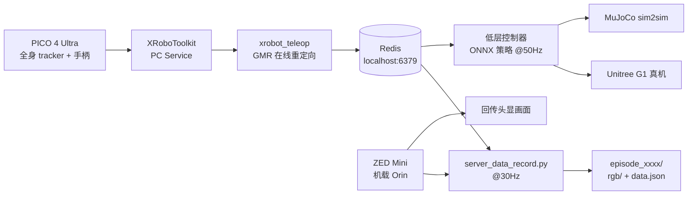

# 硬件与系统架构

上级：[[00 - TWIST2 总览]]

## 硬件清单

| 设备 | 作用 | 备注 |
| --- | --- | --- |
| Unitree G1（29 DoF） | 执行平台 | 可加 Dex3-1 灵巧手；真机走以太网，IP `192.168.123.164` |
| PICO 4 Ultra + Motion Trackers | 全身人体动捕 | 无需外部动捕基站，输出全身位姿 + 手柄/手指信号 |
| Ubuntu 笔记本（NVIDIA GPU） | 训练/部署/数据聚合 | 通过 `XRoboToolkit PC Service` 接收 PICO 数据 |
| 定制 2-DoF 脖子 | 头部俯仰/偏航 | 2x Dynamixel，ID 0 = yaw、ID 1 = pitch、2 Mbps；约 250 美元 |
| ZED Mini（机载 Orin） | 第一人称双目视觉 | 推流到头显；数据录制端从 `robot_ip:5555` 取图 |
| Redis server | 高低层通信总线 | PICO/遥操作进程与低层控制进程解耦的关键 |

USB/网络细节：笔记本与机器人直连时，笔记本设为 `192.168.123.222 / 255.255.255.0`，机器人是 `192.168.123.164`；先用 G1 遥控器 `L2+R2` 进入 dev 模式（关节阻尼态）再跑策略。

## 软件分层

| 层 | 环境 | 关键组件 | 频率 |
| --- | --- | --- | --- |
| 训练 + 低层部署 | conda `twist2`，Python 3.8 | IsaacGym、`legged_gym`、`rsl_rl`、`pose`、MuJoCo、ONNXRuntime、Redis | 策略 50 Hz |
| 在线重定向 | conda `gmr`，Python 3.10 | [GMR](https://github.com/YanjieZe/GMR)、MuJoCo、XRoboToolkit pybind | 目标 100 Hz |
| 感知与机载 | 机器人 Orin（代码不在仓库） | 脖子控制、ZED 推流、视觉回传 | - |
| 机器人 SDK | 系统级 | [YanjieZe/unitree_sdk2](https://github.com/YanjieZe/unitree_sdk2) Python 绑定 | - |

> [!warning] 双 Python 环境的原因
> IsaacGym 只支持 Python 3.8，而新版 MuJoCo/GMR 需要 Python 3.10+，所以必须 `twist2` 与 `gmr` 两个 conda 环境来回切。

## 架构图

## 仓库目录

| 路径 | 内容 |
| --- | --- |
| `assets/` | G1 URDF/XML 与 mesh、示例动作 pkl、ONNX ckpt（20k/25k） |
| `deploy_real/` | 低层 sim/real server、motion server、遥操作脚本、数据录制、robot 封装 |
| `legged_gym/` | 训练环境与任务配置（`g1_mimic*`）、奖励、域随机化、训练/play/ONNX 脚本 |
| `rsl_rl/` | 改造版 PPO/DAgger、ActorCriticMimic/Teleop/Future、runner |
| `pose/` | 动作库（motion_lib）、retargeting 辅助、骨架工具，来自团队自研栈 |
| `doc/` | 真机指南（`unitree_g1.md` / 中文版）、遥操作说明、脖子组装说明 |
| 根目录 `*.sh` | `train / to_onnx / sim2sim / sim2real / teleop / run_motion_server / data_record / gui / eval` |

## 设计要点

1. **三层解耦**：感知层（PICO/ZED/脖子）、决策层（遥操作与重定向、motion server）、执行层（RL 追踪策略）。层间只通过 Redis 传 JSON，换机器人或换策略不影响其他层。
2. **仿真与真机共用一套低层代码**：`server_low_level_g1_sim.py` 与 `..._real.py` 的观测构造、ONNX 推理、动作缩放完全一致，只替换环境 wrapper。
3. **可移植性优先**：训练在 IsaacGym，验证/部署在 MuJoCo 与 ONNX，避免把训练框架带到真机上。
4. **头显闭环**：ZED 第一人称画面回传 VR，脖子 2-DoF 跟随，遥操作者不再"盲操"。
