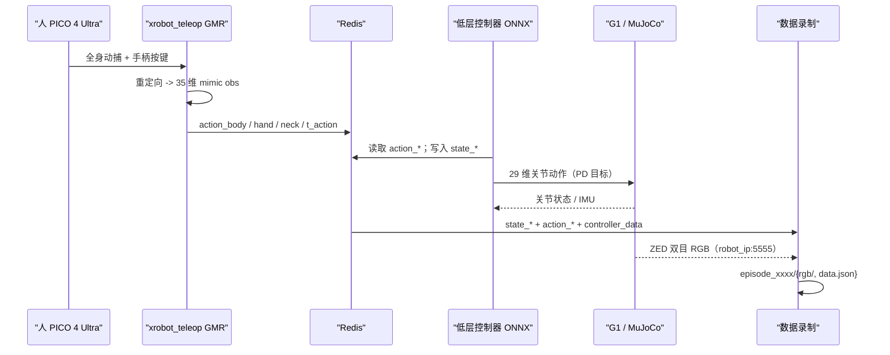

# 数据流与遥操作管线

上级：[[00 - TWIST2 总览]]

## 总体数据流



## Redis 键一览

| Key | 生产者 | 消费者 | 内容 |
| --- | --- | --- | --- |
| `action_body_unitree_g1_with_hands` | motion server（离线回放）或 xrobot_teleop（在线） | 低层控制器 | 35 维 mimic obs |
| `action_hand_left/right_unitree_g1_with_hands` | 高层 | 低层控制器 | 7 维手部姿态 |
| `action_neck_unitree_g1_with_hands` | 高层 | 低层控制器 | 2 维脖子目标 |
| `t_action` | 高层 | 数据侧 | 毫秒时间戳（时延测量用） |
| `controller_data` | 遥操作进程 | 录制/低层 | PICO 按键与摇杆 JSON |
| `state_body_unitree_g1_with_hands` | 低层控制器 | 数据录制 | 34 维：角速度 3 + roll/pitch 2 + 关节角 29 |
| `state_hand_left/right_unitree_g1_with_hands` | 低层控制器 | 数据录制 | 手部状态 |
| `state_neck_unitree_g1_with_hands` | 低层/脖子服务 | 数据录制 | 脖子状态 |
| `motion_start_signal` / `motion_exit_signal` | 真机遥控器（B / select） | motion server | 运动启动/退出握手 |

> [!info] 通信风格
> 全部是 JSON 字符串存 Redis key，没有自定义协议或 protobuf。优点是可读、易调试、进程解耦；代价是高频率下序列化开销与 `socket_timeout=0.1s` 的调参敏感。录制端用连接池 + pipeline 降低往返成本。

## 遥操作状态机

状态：`idle -> teleop -> pause -> teleop ... -> exit`

| 操作 | 按键 | 说明 |
| --- | --- | --- |
| 开始/暂停遥操作 | 右手 A（Python 里是 `key_one`） | 循环切换 teleop / pause |
| 退出遥操作 | 左手 X（`key_one`） | 回到 default pose |
| 急停 | 左手 axis click | 直接 kill `sim2real.sh` 进程 |
| 右手抓握 | index grip 闭手 / grip 开手 | 左手同理 |
| 缩小头显 RGB 窗口 | 右手 B | ZED 回传画面 |
| 运动生成模式 | 右手 axis click | 进入后用左右摇杆给 root xy / yaw 速度 |
| 数据录制 | 左手 Y 开始/暂停，axis click 退出 | `server_data_record.py` |

平滑与切换：高层在 default pose 与遥操作姿态之间做 1 秒线性插值，避免策略收到跳变参考；可选 `--smooth` 对动作流再平滑，`--pinch_mode` 用于手指捏合。

## 标定与人体尺度

- PICO 端先做全身校准，再进入 XRobot App 连到 PC 的 IP，开始全身 + 手部数据流。
- `--actual_human_height 1.6` 是作者经验值：PICO 的身高估计偏高，填小于真实身高的值重定向更稳。
- 遥操作目标频率 100 Hz，`--measure_fps 1` 打印实测帧率。

## 数据录制格式

`server_data_record.py` 默认 30 Hz，目录结构：

```text
data/<task_name>/
  episode_0000/
    data.json
    rgb/
      0000.png ...
  episode_0001/
    ...
```

- `data.json` 含两类内容：
  - 元信息：version、date、author、图像 width/height/fps
  - 语言标注：`goal`、`desc`、`steps`（代码里默认写的是 "walk ahead and pick a box" 示例，实际任务是走路 + 取箱子）
- 逐步数据按 Redis key 保存：`rgb`、`state_body/hand/neck`、`action_body/hand/neck`，即"视觉 + 本体状态 + 机器人动作"对齐。
- 图像是 ZED 双目拼接的 `(360, 1280, 3)`（左 640 + 右 640），从机器人 `robot_ip:5555` 通过共享内存传给录制进程。
- 录制开关有语音播报反馈（`speaker.py`），方便戴头显时确认状态。

> [!tip] 为什么这个格式重要
> 它同时包含第一人称视频、机器人关节状态与动作、以及语言描述，是典型的 visuomotor policy / VLA 训练样本结构，而且动作标签来自遥操作者的真实指令，而不是事后推断。

## 频率与时延

| 环节 | 频率/数值 |
| --- | --- |
| 仿真物理 | 500 Hz |
| 低层策略 | 训练与真机 50 Hz（`sim2sim.sh` 传 100 Hz，见 [[04 - 复现清单与避坑]]） |
| 遥操作数据流 | 目标 100 Hz |
| 数据录制 | 30 Hz |
| Redis 读取超时 | 0.1 s |

时延链：PICO 采集 -> PC Service -> GMR 重定向 -> Redis -> ONNX 推理 -> PD 控制 -> 执行器。仓库没有官方端到端时延数字，可用 `t_action` 时间戳 + `fps_monitor.py` 自己测。

## sim2sim 与 sim2real 流程

```bash
# 终端 A：离线动作回放（或在线遥操作）
bash run_motion_server.sh
# 或 bash teleop.sh

# 终端 B：低层控制器
bash sim2sim.sh        # MuJoCo 验证
bash sim2real.sh       # 真机（先改 sim2real.sh 里的网卡名）
```

真机前置条件：

1. 开机连接机器人，笔记本网口配置 `192.168.123.222 / 255.255.255.0`
2. `ping 192.168.123.164` 通
3. G1 遥控器 `L2+R2` 进入 dev 模式，关节进入阻尼态
4. 先跑低层控制器，再跑高层 motion server / teleop
5. 最后开 `server_data_record.py` 录数据

> [!warning] 高低层分终端运行
> 高层的 motion server / teleop 与低层控制器是两个独立进程，只通过 Redis 耦合。这个设计让"仿真换成真机"只需要换低层进程，其他不用动。
