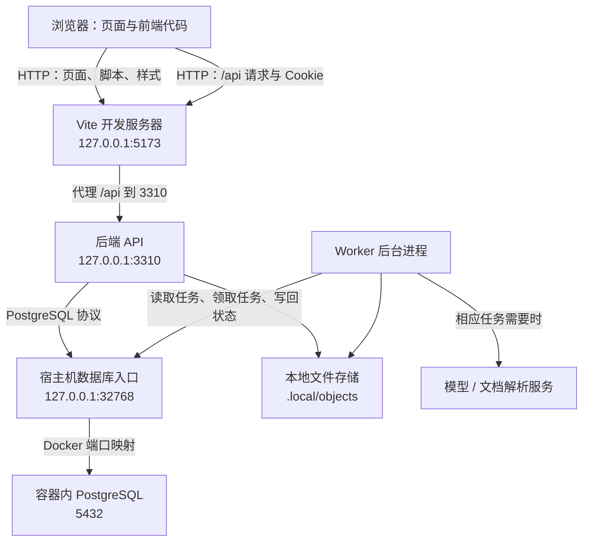
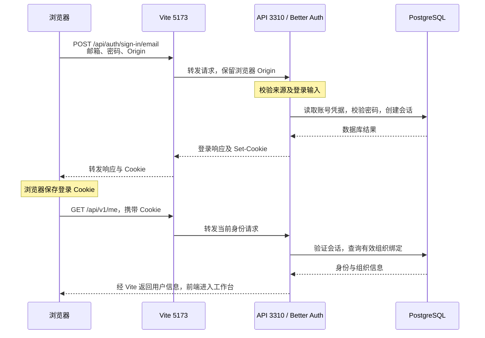

---
tags:
  - LegalAgent
  - 软件开发入门
  - 网络基础
  - 身份认证
created: 2026-10-30
updated: 2026-10-30
---

# 从浏览器到数据库：端口、前后端通信与认证入门

> [!abstract] 先抓住这条主线
> 你在浏览器里操作页面，页面代码向后端发请求；后端检查请求、确认身份和权限，再读写数据库或提交后台任务，最后把结果返回页面。
> **端口负责找到服务；认证负责确认你是谁；授权负责判断你能做什么。** 这三件事各有职责。

本文以 `D:\03_Projects\LegalAgent` 在 **2026-10-30** 的源码和本地配置为例。配置文件中的值不代表对应服务此刻一定正在运行；文中的演示命令也不表示已执行。

关联笔记：[[登录失败排查]]、[[本地docker部署]]。

建议先读第 1～5 节，再看第 6～9 节的配置与排查。最后可以用自测清单检查理解。

## 1. 项目启动以后，到底有哪些东西在工作？

“启动项目”通常是启动几个互相协作的程序，而不是只启动一个程序。

| 部分             | 在哪里运行                     | 在这个项目里做什么                               |
| -------------- | ------------------------- | --------------------------------------- |
| 浏览器里的前端代码      | Chrome、Edge 等浏览器中         | 显示登录页、案件列表、按钮；收集输入并发送请求                 |
| Web 开发服务器 Vite | 电脑上的独立进程，默认监听 5173        | 把页面、JavaScript、样式提供给浏览器；开发时转发 `/api` 请求 |
| 后端 API         | 电脑上的 Node.js 进程，默认监听 3310 | 登录、检查权限、处理业务、读写数据、提交任务                  |
| Worker         | 另一个 Node.js 进程            | 领取后台任务，执行材料处理、成果生成等耗时工作                 |
| PostgreSQL 数据库 | 当前本地方案中运行在 Docker 容器里     | 保存用户、会话、组织、案件、任务状态等数据                   |
| 文件存储           | 本地目录，或可选的对象存储服务           | 保存上传原件及其他文件内容                           |
| 模型、解析等外部服务     | 取决于具体配置                   | 在相应功能需要时提供 AI 或文档解析能力                   |
|                |                           |                                         |

前端代码和 Vite 不是同一个东西：Vite 将代码送到浏览器，浏览器再执行代码。开发时改代码，Vite 帮你快速更新页面；正式发布时，通常把前端构建成文件，再由 Web 服务提供。

TypeScript 是写程序的语言。这里既用它写前端，也用它写后端：前端最终在浏览器里运行，后端和 Worker 在 **Node.js** 里运行。React 用来组织页面，NestJS/Express 用来组织后端 HTTP 接口，Better Auth 处理账号与登录会话，PostgreSQL 保存数据。

## 2. IP、端口、路径分别是什么？

看这个地址：

```text
http://127.0.0.1:5173/api/v1/me
│      │         │    └─ 路径：请求哪个接口
│      │         └────── 端口：交给哪个网络服务
│      └──────────────── 主机地址：访问哪台机器
└─────────────────────── 协议：使用什么通信规则
```

可以把一台电脑想成一栋楼：IP 或主机名帮助找到楼，端口帮助找到接待窗口，路径说明要办理哪项业务。

### 2.1 端口不是硬件插孔

网络端口是操作系统管理的编号。某个程序“监听 3310”，意思是它准备接收发往这个端口的连接。

- 访问 `127.0.0.1:5173`，通常先找到 Vite。
- 访问 `127.0.0.1:3310`，通常先找到后端 API。
- 数据库使用自己的端口和协议，并不因为有端口就能用浏览器直接浏览。

这些编号主要是项目约定。`5173` 不天然表示前端，`3310` 也不天然表示后端。可以改，但相关的连接目标必须一起更新。

在普通开发场景里，同一网络环境中，两个程序通常不能同时占用同一个 TCP 监听地址和端口。如果遇到 `EADDRINUSE`，表示对应地址和端口已被占用。本项目的 Vite 设置了 `strictPort: true`：5173 被占用时会报错，不会自动悄悄换到 5174。

浏览器也有自己的连接源端口，通常由操作系统临时分配。初学阶段主要关心服务端监听的端口即可。

### 2.2 `127.0.0.1`、`localhost`、`0.0.0.0`

| 写法 | 含义 | 这里要注意什么 |
| --- | --- | --- |
| `127.0.0.1` | IPv4 回环地址，指向当前机器 | 本地开发优先统一用它 |
| `localhost` | 本机名称，通常解析到回环地址 | 可能解析到 IPv4 或 IPv6；与 `127.0.0.1` 在浏览器中不是相同主机名 |
| `0.0.0.0` | 服务监听所有 IPv4 网络接口 | 用于监听配置；浏览器应使用实际 IP 或域名访问 |
| `192.168.x.x` 等 | 可能是局域网中的机器地址 | 别人访问你的服务时，要使用你的可达地址，而不是他们自己的回环地址 |

**回环地址永远相对于使用它的环境。** 你电脑浏览器里的 `127.0.0.1` 指你的电脑；Docker 容器里的 `127.0.0.1` 通常指那个容器本身。在容器之间连接数据库时，往往使用 Compose 服务名，例如 `postgres:5432`，不能直接照搬宿主机的回环地址。

仅仅改成监听 `0.0.0.0`，也不保证其他电脑能连上；防火墙、网络路由和允许的访问来源仍会影响连接。

### 2.3 端口和路径是两层概念

同一个后端端口可以提供很多接口：

```text
3310
├─ /api/auth/sign-in/email    登录
├─ /api/auth/sign-out         退出
├─ /api/v1/me                 当前用户信息
├─ /api/v1/matters            案件相关业务
├─ /health/live               进程存活检查
└─ /health/ready              数据库就绪检查
```

`API` 可以理解为程序之间约定好的服务入口。一个 HTTP 接口通常由“请求方法 + 路径 + 输入格式”共同定义。例如 `GET /api/v1/me` 查询当前用户，`POST /api/auth/sign-in/email` 提交登录信息。

## 3. 当前本地开发的连接关系



> [!info] 图中的 32768 从哪里来？
> 本次读取根目录 `.env.local` 时，数据库地址中的端口是 **32768**；这是配置快照，不是固定标准，也未据此确认运行中的数据库连接。
> `compose.yaml` 将宿主机端口映射到容器的 5432。`scripts/postgres.mjs` 使用动态分配端口，再查询实际映射，并由初始化脚本写入 `DATABASE_URL`。容器重建后端口可能变化，应以更新后的配置为准。

### 3.1 浏览器为什么访问 5173，却能调用 3310？

因为 Vite 配置了代理规则：

```text
浏览器请求：http://127.0.0.1:5173/api/v1/me
Vite 转发到：http://127.0.0.1:3310/api/v1/me
后端响应 → Vite → 浏览器
```

前端代码写的是相对路径：

```javascript
fetch('/api/v1/me', { credentials: 'same-origin' })
```

相对路径会使用当前网页的协议、主机和端口。因此，当页面地址是 `http://127.0.0.1:5173` 时，请求也先发给 5173。代理随后建立到后端的连接，浏览器看到的请求地址依然是 5173。

代理可以理解为代收、转交请求的服务。这里的作用是：**浏览器只面对一个 Web 入口，由这个入口转发 API 请求。**

### 3.2 浏览器为什么不直接连数据库？

浏览器把“我要查询案件”交给后端，后端确认权限后，再用数据库协议执行查询。

```text
浏览器 --HTTP--> API --PostgreSQL 协议--> 数据库
```

数据库账号允许做的事情通常比某个网页用户多。如果把数据库密码和直接查询能力交给浏览器，就很难保证每个用户只能访问自己有权查看的数据。后端在这里负责管理业务规则、权限和数据库连接。

浏览器用户密码与数据库密码也是两套凭据：前者确认“哪个人登录了”，后者确认“哪个程序可以连接数据库”。

### 3.3 Worker 为什么也需要启动？

API 可以很快记录一项任务并返回“已提交”，Worker 再领取任务，执行耗时处理并写回结果。

```text
前端提交任务 → API 写入数据库 → Worker 领取并处理
                                      ↓
前端通过 API 获取状态与成果 ← 数据库和文件存储
```

当前源码的任务消费使用 PostgreSQL；健康能力接口也声明 `redisRequired: false`。不要因为设计文档提过 Redis，就认为当前启动一定需要 Redis。

当前 Worker 入口没有启动面向浏览器的 HTTP 服务，所以通常不需要给它找一个“网页端口”。但它仍然会主动连接数据库、模型或解析服务。

**页面能打开、能登录，不代表 Worker 正在处理任务。** 如果任务一直排队，应继续检查 Worker 和相应依赖。

## 4. 一次登录到底发生了什么？

### 4.1 第一次输入邮箱和密码



Better Auth 是运行在后端进程里的认证库，不是还要额外启动、额外占一个端口的服务。它借助 PostgreSQL 保存账号和会话等信息。密码通常以不可直接还原的哈希形式保存，登录时进行校验。

### 4.2 为什么后续点按钮不用再输入密码？

HTTP 请求本身不会天然记住“上一个请求是谁发的”。登录成功后，服务端建立 **Session（会话）**，浏览器保存用于识别会话的 **Cookie**。

可以把它理解为：

- 邮箱、密码：办理登录时的身份证明。
- Session：服务端记录的登录状态，有过期时间。
- Cookie：浏览器后续请求附带的会话凭据。

这里的前端配置为 `credentials: 'same-origin'`，对同源请求携带符合条件的 Cookie。后端读取 Cookie、验证会话，再确认用户所属组织。

登录 Cookie 不是数据库密码，也不是模型 API Key。`AUTH_SESSION_SECRET` 又是另一种配置：它是认证系统使用的服务端密钥，不是用户的登录密码。

### 4.3 登录账号存在，为什么仍然进不了工作台？

项目在“账号认证成功”之外，还要求账号具有有效的组织绑定。

```text
账号存在且密码正确
  → 会话有效
  → 用户属于有效组织
  → 对所请求案件或操作有权限
  → 业务才允许执行
```

例如，一个账号被组织释放后，账号本身还在，也可能仍有认证会话；但业务身份检查查不到有效组织绑定，就会拒绝进入工作台。

这也是为什么不能只给登录页加一个普通“注册”按钮就算完成：创建账号以后，还必须有明确的组织加入或创建流程。

当前项目已有邀请注册：组织所有者在“邀请加入”生成链接，新用户打开 `/invite/<token>` 页面，填写姓名、邮箱、密码，后端创建或确认账号并绑定组织，然后前端按正常流程登录。

## 5. 为什么已经连通了，还会被各种检查拦住？

网络连通只说明请求能送达，不表示请求一定被允许。每项检查回答的问题不同。

| 层次 / 名称 | 它在问什么 | 例子 |
| --- | --- | --- |
| 网络、监听、防火墙 | 请求能到达对应服务吗？ | API 没启动，连接被拒绝 |
| Origin / Host 校验 | 请求来自允许的网页入口吗？访问的主机被允许吗？ | 5173 没被信任，出现 `Invalid origin` |
| 身份认证 Authentication | 你是谁？会话是否有效？ | 没有 Cookie、会话过期，返回 401 |
| 组织绑定检查 | 你是否属于有效组织？ | 账号存在，但没有有效组织绑定，返回 403 |
| 业务授权 Authorization | 你能对这个案件执行这个动作吗？ | 普通成员不能生成组织邀请 |
| 输入校验 Validation | 请求内容是否符合接口规则？ | 缺字段、错误类型、非法参数 |
| 限流 Rate limiting | 请求是否过于频繁？ | 连续多次登录，返回 429 |
| 健康检查 Health check | 当前服务的某项依赖或能力正常吗？ | API 存活，但数据库连接失败 |

这是一张理解用的分层表，不代表每个接口都按同一顺序运行所有检查。例如邀请接口允许尚未登录的用户访问；`/health/live` 不要求数据库正常。

### 5.1 Origin 是什么？为什么两个本地地址也不同？

在本文的普通 HTTP/HTTPS 地址里，**Origin（源）由协议、主机和有效端口组成，不包含路径。**

| 两个地址 | 是否同源 | 原因 |
| --- | --- | --- |
| `http://127.0.0.1:5173/` 与 `http://127.0.0.1:5173/api/v1/me` | 是 | 只有路径不同 |
| `http://127.0.0.1:5173` 与 `http://127.0.0.1:3310` | 否 | 端口不同 |
| `http://localhost:5173` 与 `http://127.0.0.1:5173` | 否 | 主机名不同 |
| `http://example.com` 与 `https://example.com` | 否 | 协议不同 |

浏览器在相应请求中会带上 `Origin` 请求头。后端的 `trustedOrigins` 是允许的来源列表，用于判断某个来源是否可信。

后端不能把“客户端报来的任意 Origin”直接加入信任列表，否则检查失去意义。可以通过统一开发配置或启动脚本协调地址，但不能用无条件信任来代替配置。

### 5.2 CORS、CSRF、登录认证，分别管什么？

| 概念 | 通俗解释 | 与本项目的关系 |
| --- | --- | --- |
| 同源策略 | 浏览器限制网页脚本读取其他来源的数据 | 5173 和 3310 在浏览器看来是不同来源 |
| CORS，跨源资源共享 | 服务端通过响应头告诉浏览器，允许哪些跨源脚本访问响应；一些请求还会先发预检 | 当前同源 `/api` 代理方式通常避免了浏览器直接跨源调用后端 |
| CSRF，跨站请求伪造 | 防止其他网站利用浏览器已有的登录凭据，诱导它向本站执行操作 | 来源检查、Cookie 策略等可参与防护；Better Auth 的来源校验与这类防护有关 |
| 登录认证 | 验证账号凭据或登录会话 | Cookie 有效，才知道用户是谁 |
| 业务授权 | 判断这个用户是否有权执行具体操作 | 登录用户也不能查看所有案件 |

**允许 CORS 不等于已经登录，也不等于拥有权限。** CORS 本身也不能保证所有跨站请求都不会发出，不能把它当作完整的 CSRF 防护。

用 PowerShell 或命令行发送 HTTP 请求，没有浏览器那一层同源限制，但仍然会受到后端的来源、认证和权限检查。因此“命令行成功、浏览器失败”值得对比请求头、Cookie 和跨源行为。

### 5.3 Cookie 和端口的一个容易混淆的细节

Cookie 的匹配主要与主机/域、路径、Secure、SameSite 等规则有关，**Cookie 本身不按端口隔离**；但浏览器同源判断包含端口。

所以不能说“5173 和 3310 端口不同，Cookie 就一定不共享”。在本项目里，还要看 `credentials: 'same-origin'`、具体请求地址、浏览器策略和后端检查。

`localhost` 和 `127.0.0.1` 是不同主机表示，不应期待两者的登录 Cookie 自动通用。固定使用一个浏览器入口，最容易排查问题。

HTTPS 负责加密传输，避免登录密码等信息在传输中被明文读取；它不代替认证或权限判断。本地开发可以用 HTTP，正式外部访问应使用配置正确的 HTTPS。

## 6. 把项目配置对应到刚才的关系图

| 配置项 | 谁读取 | 实际作用 |
| --- | --- | --- |
| `LEGALAGENT_API_PORT` | API；Vite 进程也可读取 | API 实际监听端口；Vite 在没有显式目标时据此计算代理目标 |
| `LEGALAGENT_API_HOST` | API | 决定监听回环地址还是其他允许的绑定地址 |
| `AUTH_URL` | API / Worker 的配置；生产 Web 网关也读取 | 认证与业务使用的规范地址，项目还用它生成下载、预览等 URL；不决定 API 监听端口 |
| `LEGALAGENT_API_TARGET` | Vite 配置 | 显式指定开发代理的后端目标，优先于根据 API 端口计算的地址 |
| `LEGALAGENT_FRONTEND_ORIGIN` | 当前工作区新增的后端配置 | 提供额外可信前端来源；这是尚未整理完成的本地修改 |
| `DATABASE_URL` | API / Worker 的配置与数据库客户端 | 数据库连接信息：协议、账号、密码、主机、端口、数据库名 |
| `AUTH_SESSION_SECRET` | Better Auth | 认证系统的服务端密钥 |
| `LEGALAGENT_BLOB_DIRECTORY` | 本地文件存储 | 文件内容保存的目录，默认 `.local/objects` |
| `WEB_PORT`、`API_UPSTREAM_URL`、`WEB_PUBLIC_ORIGINS` | `serve:web` 的 Web 网关 | 生产静态 Web 服务端口、内部 API 目标、额外可信入口；不是 Vite 的配置项 |

### 6.1 本地 Vite 模式的一组协调配置

当浏览器固定访问 `http://127.0.0.1:5173`，API 仍监听 3310 时：

```dotenv
# 浏览器入口；认证和业务生成的 URL 都要与该入口协调。
AUTH_URL=http://127.0.0.1:5173

# API 实际监听的地址和端口。
LEGALAGENT_API_HOST=127.0.0.1
LEGALAGENT_API_PORT=3310
```

`AUTH_URL` 写 5173 不会让 API 改去监听 5173。API 监听由 `LEGALAGENT_API_HOST` 和 `LEGALAGENT_API_PORT` 决定。

数据库连接的结构如下，密码是占位符，不要原样复制运行：

```text
postgresql://legalagent:<数据库密码>@127.0.0.1:32768/legalagent
             账号      密码          主机      端口   数据库名
```

实际数据库地址应使用初始化脚本生成的 `DATABASE_URL`，不要根据图中示例手工猜一个端口。

### 6.2 为什么只增加 trustedOrigins 还不算完整处理？

当前工作区把 `AUTH_URL` 保持在 3310，再额外信任前端 5173。这能解决特定来源的认证请求被拒问题，但项目还根据 `AUTH_URL` 生成文件 URL。

如果返回给浏览器的是 `http://127.0.0.1:3310/...`，浏览器就可能绕过 5173 直接请求后端，从而遇到跨源请求、凭据策略或预览同源检查问题。

本地 Vite 模式推荐让 `AUTH_URL` 与浏览器入口协调，让浏览器 API 和文件请求经过同一个 Web 入口。这不意味着所有部署都只能有一个可信来源；多入口和代理场景需要有明确的配置规则。

> [!note] 当前源码修改状态
> 2026-10-30 本次对话前一轮检查中，`config.ts` 新增的 `frontendOrigin` 有重复声明和重复赋值，`auth.ts` 的 `.filter(Boolean)` 也没有将数组类型收窄为 `string[]`；后端类型检查未通过。本笔记没有修复这些代码，也没有修改运行配置。
> 程序能在开发模式运行，不代表它一定通过 TypeScript 类型检查或正式构建。

### 6.3 `.env.local` 不是所有进程自动共享的全局配置

环境变量是进程读取的配置，例如 API 从 `process.env` 获取端口和数据库地址。不同终端启动的是不同进程，它们读到的变量可能不同。

当前根目录的 `dev` 和 `worker` 命令显式加载根 `.env`、`.env.local`。在这些命令里，已经存在的进程环境变量优先；同名变量在后加载的 `.env.local` 中可以覆盖 `.env` 的文件值。

Vite 当前配置从其进程环境读取 `LEGALAGENT_API_TARGET` 或 `LEGALAGENT_API_PORT`，并不自动把根 `.env.local` 的后端设置当成代理目标。只改根文件，不保证另一个终端启动的 Vite 读到同样的值。

当前 `serve:web` 命令是 `node scripts/serve-web.mjs`，没有像 API 那样带根 env 文件加载参数。其配置需要由启动环境或显式加载方式提供。

修改文件后，已经运行的 API / Worker 通常需要重启才能读到新值。当前 PowerShell 中通过 `$env:...` 设置的变量也会在该终端保留；新开另一个终端并不自动继承这次临时设置。

### 6.4 `dev:setup` 做什么？会不会每次都重写配置？

当前初始化脚本会启动或复用本项目开发数据库、查询端口映射、写入数据库连接、执行迁移，并创建或确认开发账号及其组织所有者身份。

它为**缺失项**添加默认值，包括 `AUTH_URL=http://127.0.0.1:3310`。当前 `updateEnvFile` 会保留已有 `AUTH_URL`，并非每次都强制重置为 3310；`DATABASE_URL` 则会更新为本次确认的数据库连接。

第一次生成 3310 的默认值主要服务 API-only/demo 用法；运行浏览器工作台时，要另外协调 Web 地址。初始化脚本不是所有业务都需要反复执行的启动按钮。

## 7. 用 PowerShell 理解三个启动终端

以下是在仓库根目录执行的**示例**，假设依赖、数据库和迁移已经准备好，并且已解决当前源码类型错误。这里用进程环境变量显式覆盖 `AUTH_URL`，便于看懂每个终端负责什么。

终端 1，运行 API：

```powershell
Set-Location 'D:\03_Projects\LegalAgent'
$env:AUTH_URL = 'http://127.0.0.1:5173'
npm run dev
```

终端 2，运行 Worker：

```powershell
Set-Location 'D:\03_Projects\LegalAgent'
$env:AUTH_URL = 'http://127.0.0.1:5173'
npm run worker
```

终端 3，运行 Vite：

```powershell
Set-Location 'D:\03_Projects\LegalAgent'
npm run dev --workspace @legalagent/web
```

然后在浏览器访问：`http://127.0.0.1:5173`。

如果 API 改成 3320，则 API 终端要设置 `LEGALAGENT_API_PORT=3320`，Vite 终端也要把代理目标更新到该端口；Worker 可使用同一套配置。浏览器入口没变时，`AUTH_URL` 仍可以是 5173。

如果改的是 Vite 端口，则要修改 Vite 的监听配置或启动参数，并同步浏览器访问地址及 API / Worker 使用的 `AUTH_URL`。

**改哪一段地址，就检查连接到它的那一段配置。** 不需要把所有端口都改成一样。

## 8. 数据库、文件、迁移：分别保存什么？

### 8.1 数据库保存结构化记录

可以先把数据库中的表理解成有明确字段和关联规则的数据表。例如认证表保存账号和会话，业务表保存组织、成员、案件、任务等记录。后端使用数据库连接池管理一组可复用连接，避免每次请求都重新建立连接。

后端中的 `pg` 等工具负责与 PostgreSQL 通信。使用 SQL 或数据库库，不会绕过权限设计；代码仍需要先判断用户能操作哪些记录。

### 8.2 文件内容和数据库记录需要配合

当前默认本地存储把文件字节保存到 `.local/objects` 等配置目录，数据库保存文档身份、版本、存储引用及业务状态等信息。

因此，备份数据库并不自动等于备份了所有原件；只复制文件目录，也不自动恢复组织、案件和文件之间的关系。恢复一个可用项目要考虑数据库、文件和必要配置的协调。

### 8.3 迁移 Migration 是什么？

程序需要的表不会因为写了 TypeScript 接口就自动存在。数据库迁移负责创建或调整表、索引等结构，使数据库适配当前代码。

当前 `dev:setup` 会执行业务数据库迁移和 Better Auth 迁移。只启动 PostgreSQL 容器，不一定意味着它已经有应用所需的表；登录页也可能先显示出来，直到第一次操作数据库时才暴露问题。

迁移与数据初始化也不同：前者准备结构，后者可能创建开发账号、组织等初始记录。

### 8.4 Docker、镜像、容器、数据卷

- **镜像**：启动 PostgreSQL 所用的软件模板。
- **容器**：基于模板启动的运行环境，PostgreSQL 在其中工作。
- **端口映射**：让宿主机端口的连接转到容器内的 5432。
- **数据卷 Volume**：保存数据库文件，使容器生命周期与数据保存分开管理。

停止应用进程不等于删除数据库；停止或删除容器也不一定删除数据卷。带删除数据卷的清理操作则可能删除数据，不应把它当作普通的“重启服务”。

## 9. 出问题时，按请求经过的顺序查

### 9.1 先找到第一个失败的请求

浏览器按 `F12` 打开开发者工具，选择 **Network / 网络**，再触发一次操作。记录：

1. 请求 URL：发往 5173 还是直接发往 3310？
2. 方法：GET、POST 还是其他？
3. 状态码：401、403、502，还是没有收到 HTTP 响应？
4. 响应中的错误 `code`、可用的 `requestId`。
5. 请求的 `Origin`，以及是否携带了 Cookie；不要把 Cookie 值粘贴到公开笔记。

登录相关重点看 `POST /api/auth/sign-in/email` 和其后的 `GET /api/v1/me`。两者回答不同问题：前者登录，后者确认可用于业务的当前身份。先确认哪一步失败，再判断是密码、来源、会话还是组织绑定问题。

### 9.2 常见现象和下一步

| 现象 | 可以先怎样理解 | 下一步检查 |
| --- | --- | --- |
| 页面打不开，`ERR_CONNECTION_REFUSED` | 目标地址没有可接收连接的服务，或连接被拒绝 | Web 是否启动、地址端口是否正确 |
| 页面能打开，API 返回 502 | 网关未能正常取得上游响应 | API 是否启动、代理目标是否正确、后端日志 |
| 登录日志出现 `Invalid origin` | 请求来源与后端信任配置不符 | 浏览器实际入口、`AUTH_URL`、可信来源、代理类型 |
| 登录返回 401 | 常见为账号或密码错误；其他接口也可能表示会话无效 | 哪个接口失败、响应错误码、凭据与会话 |
| 登录后 `/api/v1/me` 返回 403 | 当前代码常见原因是没有有效组织绑定 | 组织成员状态、邀请或释放流程 |
| 某个业务操作返回 403 | 也可能只是缺少该操作权限 | 当前用户角色、案件权限、来源检查；不能只看状态码就认定密码错 |
| 预览或下载失败，地址变成 3310 | 生成的文件 URL 可能与浏览器入口不协调 | `AUTH_URL`、返回的 URL、是否经过同源代理 |
| 浏览器显示 CORS 错误 | 网页脚本遇到跨源访问限制 | 为什么请求跨源、响应头、底层实际响应；不是直接去重置密码 |
| 数据库连接失败或密码认证失败 | API 到数据库这一段出问题 | Docker 映射、`DATABASE_URL`、数据库凭据和迁移 |
| 任务一直排队 | 接收任务的 API 正常，不代表处理任务的 Worker 正常 | Worker 日志、任务状态、所需外部服务 |
| 429 | 请求过于频繁 | 响应提示、限流配置、是否重复提交 |
| 500 | 服务端处理失败 | 用请求时间和 requestId 对照后端日志 |

同样的 403 可能来自不同检查。`LoginPage.tsx` 当前对 403 的提示偏向账号权限，但实际也可能是认证来源问题，所以需要结合 Network 和后端日志。

### 9.3 几个只读的 PowerShell 检查

查看常用 Web/API 端口是否有监听进程：

```powershell
Get-NetTCPConnection -State Listen -ErrorAction SilentlyContinue |
  Where-Object { $_.LocalPort -in 5173, 3310 } |
  Select-Object LocalAddress, LocalPort, OwningProcess
```

`OwningProcess` 是进程编号 PID。知道 PID 后，可以用 `Get-Process -Id <实际PID>` 查询程序。看见监听进程只说明有服务占着端口，还不能说明业务正常。

检查 API 自身存活及数据库就绪：

```powershell
Invoke-RestMethod 'http://127.0.0.1:3310/health/live'
Invoke-RestMethod 'http://127.0.0.1:3310/health/ready'
```

查看 Docker 容器及端口映射：

```powershell
docker ps --format 'table {{.Names}}\t{{.Status}}\t{{.Ports}}'
```

当前初始化脚本使用独立的 Compose 项目名。手动执行 `docker compose ps` 时，如果项目名与初始化脚本使用的名字不同，看到空列表不一定意味着数据库没启动；可以先用 `docker ps` 查看运行中的容器。

### 9.4 健康检查到底能证明多少？

| 检查结果 | 当前源码中能说明什么 | 尚不能据此确认什么 |
| --- | --- | --- |
| 页面返回 200 | Web 入口能提供页面 | API、数据库、登录、模型任务是否正常 |
| `/health/live` 返回 UP | API 能处理这条存活请求 | 数据库和业务依赖是否正常 |
| `/health/ready` 返回 UP | API 能向数据库执行 `SELECT 1` | 全部迁移、账号、Worker、外部模型是否正常 |
| `/health/capabilities` 返回能力信息 | 能查看声明的能力及配置状态 | 标为 `NOT_PROBED` 的服务没有因此被连通性验证 |
| 登录并进入工作台 | 该次登录、会话及组织身份路径成功 | 所有案件操作与后台任务是否成功 |
| 一项完整任务成功 | 这次输入、配置、权限下的相关链路成功 | 所有其他功能和负载条件都正常 |

## 10. “类型检查、测试、构建”和运行中的检查有什么区别？

| 名称 | 发生在什么时候 | 检查什么 |
| --- | --- | --- |
| TypeScript 类型检查 | 开发或构建时 | 字段、函数参数、类型等是否符合代码约束 |
| 单元 / 组件测试 | 开发验证时 | 某段逻辑或页面在测试条件下是否符合预期 |
| 集成测试 | 开发验证时 | 多个组件或真实数据库等依赖能否协作 |
| 构建 Build | 发布准备时 | 能否产出后端或前端运行所需文件 |
| 运行时输入检查 | 每次处理外部请求等输入时 | 真实输入是不是合法；外部输入不能因写了 TS 类型就被信任 |
| 认证与权限检查 | 处理相应请求时 | 这次请求是谁发的、能否执行 |
| 端到端验证 E2E | 通过完整操作链验证时 | 页面、网络、后端、数据库等是否真的一起完成操作 |

例如，`.filter(Boolean)` 在 JavaScript 运行时可以过滤掉 `undefined`，但当前 TypeScript 配置未据此把数组类型推断为 `string[]`，于是类型检查仍然报错。开发模式使用的执行工具可以运行代码，但这不等于类型检查通过。

反过来，类型检查通过也不保证 Docker 已启动、数据库密码正确或模型服务可用。不同检查证明不同层面的事情。

## 11. 正式部署与本地开发哪里不同？

正式部署常见关系是：

```text
浏览器访问 https://law.example
             ↓
Web 网关 / 反向代理，通常对外提供 HTTPS 443
  ├─ /             → 前端构建文件
  └─ /api/...      → 内部 API:3310
                          ↓
                    内部数据库和文件存储
                          ↑
                       Worker
```

浏览器只看到公开域名，内部 API 和数据库端口可以继续各用各的。443 是 HTTPS 常用端口，地址栏通常省略它。

项目的 `scripts/serve-web.mjs` 与开发 Vite 代理有一处重要区别：

- **Vite 开发代理**：当前配置保留浏览器 Origin，不替你统一认证来源。
- **生产 Web 网关脚本**：先检查允许的 Host / Origin，再把请求 Origin 转换为配置的 canonical origin（规范来源），还会调整符合规则的 API 元数据 URL。

因此，不能把两种代理的规则混在一起推理。生产网关中的 canonical origin 要和后端配置匹配，实际外部入口要满足网关允许规则；内部连接目标由 `API_UPSTREAM_URL` 指定。使用其他反向代理时，也需要检查其实际规则。

> [!tip] 对已有排查笔记的补充
> [[登录失败排查]] 中“生产环境为什么没有这个问题”应理解为“规范配置的同源部署能够避免这类不匹配”，不能理解成生产环境天然不会发生认证来源问题。
> `AUTH_URL` 也不只是“后端告诉前端自己在哪”的地址；它在当前代码中同时参与认证、来源协调和业务 URL 生成。前端实际调用 API 主要使用相对路径。

## 12. 回到这次发现的两个问题

**认证来源问题：** 当前项目已有 Web 地址配置方法，但首次初始化默认值和浏览器开发入口需要手工协调。改进方向是统一启动配置、清楚显示实际监听地址与浏览器入口，并在不一致时给出有用提示。问题不是“所有端口都应该一样”，而是“每条连接和每项校验应知道自己该使用哪个地址”。

**注册入口问题：** 当前已经有“组织邀请 → 创建或确认账号 → 绑定组织 → 登录”的流程。登录页需要更明确地告诉用户如何取得邀请。若要实现任何人都能公开注册，还需要设计组织创建、所有者初始化和其他账号管理流程。

## 13. 读完后可以自己回答的几个问题

- [ ] 浏览器请求 `5173/api/v1/me`，为什么最后是 3310 的 API 处理？
- [ ] API 明明监听 3310，为什么本地 Web 模式的 `AUTH_URL` 可以设为 5173？
- [ ] 为什么 5173、3310、32768、5432 不需要改成同一个编号？
- [ ] 为什么数据库容器启动了，不代表 API 已经成功连接数据库？
- [ ] 为什么知道用户密码正确，仍然不能判断他有权查看某个案件？
- [ ] 为什么同样的 403，要结合具体接口和错误码分析？
- [ ] Cookie、用户密码、数据库密码、模型 API Key 分别服务于哪段关系？
- [ ] 为什么能登录不代表 Worker 正在工作？
- [ ] 为什么 `/health/ready` 成功不代表真实模型任务一定成功？
- [ ] 改动哪个端口时，需要同步检查哪些连接目标？

## 14. 对照源码继续阅读

下面这些位置已按本次源码核对。先从启动、代理、登录、身份检查这条线读，不必一开始读完整个仓库。

| 要理解的问题 | 源码入口 |
| --- | --- |
| npm 命令到底启动了什么 | [根 package.json](D:/03_Projects/LegalAgent/package.json) |
| Web 本地运行的配置关系 | [Web README](D:/03_Projects/LegalAgent/apps/web/README.md) |
| Vite 把 `/api` 转发到哪里 | [vite.config.ts](D:/03_Projects/LegalAgent/apps/web/vite.config.ts) |
| 前端如何提交邮箱和密码 | [auth-client.ts](D:/03_Projects/LegalAgent/apps/web/src/modules/auth/auth-client.ts) |
| 登录后如何刷新当前身份 | [AuthProvider.tsx](D:/03_Projects/LegalAgent/apps/web/src/modules/auth/AuthProvider.tsx) |
| 普通业务请求如何携带 Cookie | [前端 API client](D:/03_Projects/LegalAgent/apps/web/src/shared/api/client.ts) |
| 后端配置、实际监听与认证 | [config.ts](D:/03_Projects/LegalAgent/apps/server/src/config.ts)、[HTTP main.ts](D:/03_Projects/LegalAgent/apps/server/src/http/main.ts)、[auth.ts](D:/03_Projects/LegalAgent/apps/server/src/auth.ts) |
| 健康检查、认证路由、业务身份检查顺序 | [application.ts](D:/03_Projects/LegalAgent/apps/server/src/http/application.ts) |
| Docker 数据库和端口映射 | [compose.yaml](D:/03_Projects/LegalAgent/compose.yaml)、[postgres.mjs](D:/03_Projects/LegalAgent/scripts/postgres.mjs) |
| 初始化数据库、账号和环境文件 | [setup-local.ts](D:/03_Projects/LegalAgent/scripts/setup-local.ts)、[env-file.ts](D:/03_Projects/LegalAgent/scripts/env-file.ts) |
| Worker 如何开始处理后台工作 | [worker.ts](D:/03_Projects/LegalAgent/apps/server/src/worker.ts) |
| 生产 Web 网关的来源校验和转发 | [serve-web.mjs](D:/03_Projects/LegalAgent/scripts/serve-web.mjs) |
| 邀请注册页面与组织绑定 | [InvitePage.tsx](D:/03_Projects/LegalAgent/apps/web/src/modules/auth/InvitePage.tsx)、[invite-acceptance-service.ts](D:/03_Projects/LegalAgent/apps/server/src/organization-admin/invite-acceptance-service.ts) |

这是当前项目的入门知识笔记；后续若更换启动方式、端口、代理或认证方案，应对照源码更新其中的项目配置部分。
